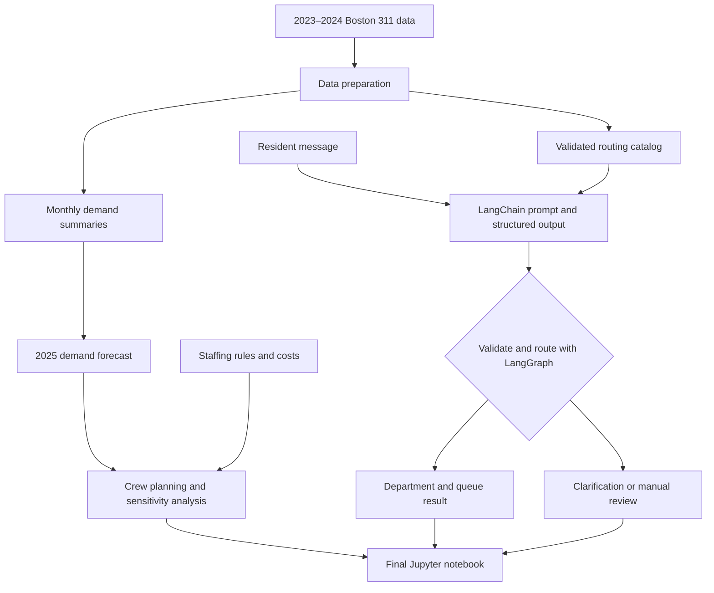

# Boston 311 Crew Planner

A DADS 5250 hackathon project for planning monthly field crews across four Boston city departments, supported by a GenAI resident intake assistant.

**Status:** In development

## Project Goal

Use Boston’s 2023–2024 service request data to decide how many crews each department needs in every month of 2025.

The staffing plan will balance cost, service demand, and timely completion while respecting the challenge’s hiring, release, and seasonal staffing rules.

The project also includes a GenAI assistant that converts a resident’s plain-language complaint into a valid request type, department, and queue.

## Departments in Scope

| Department | Code |
|---|---|
| Public Works | PWDx |
| Transportation | BTDT |
| Parks & Recreation | PARK |
| Inspectional Services | ISD |

## Planned Features

1. Clean and summarize historical service requests.
2. Estimate monthly demand for each department in 2025.
3. Generate a monthly staffing plan, including hires, releases, and seasonal crews.
4. Compare results under baseline demand and demand changes of ±20%.
5. Classify resident messages using a catalog of valid service routes.
6. Evaluate the intake assistant using 30–50 labeled test messages.

## Architecture



The staffing analysis and intake assistant share prepared historical data. Individual demo messages do not automatically change the annual demand forecast.

## Technology and Course Techniques

| Tool or technique | Purpose |
|---|---|
| Python and pandas | Data preparation, aggregation, and staffing calculations |
| Jupyter Notebook | Development, demonstration, and final submission |
| LangChain | Model integration and prompt execution |
| Prompt engineering | Guide classification using supported request types |
| Structured output | Produce predictable, validated response fields |
| LangGraph | Conditional routing to department or clarification nodes |
| Matplotlib | Visualize demand and staffing results |

The GenAI implementation will follow the course examples. Other agent SDKs and frameworks will not be used.

## Data

Source: [City of Boston 311 Service Requests](https://data.boston.gov/dataset/311-service-requests)

Historical files:

- `lagan_311_open_data_2023_rvsd3.csv`
- `lagan_311_open_data_2024_rvsd3.csv`

Download the files and place them in `data/raw/`.

Large raw datasets are excluded from version control. Small derived tables and the curated routing catalog will be included where appropriate.

The data contains request categories and routing information, but not resident free-text descriptions. Intake evaluation messages will therefore be synthetic and manually reviewed by the team.

## Proposed Repository Structure

```text
data/raw/          Downloaded source CSV files; excluded from Git
data/processed/    Monthly summaries and routing catalog
notebooks/         Individual development notebooks
src/               Shared Python functions
outputs/           Forecasts, staffing tables, charts, and evaluation results
docs/              Architecture and demo materials
README.md          Project overview and setup instructions
requirements.txt   Tested Python dependencies
.env.example       Environment variable template without secrets
.gitignore         Files excluded from version control
```

The final integrated submission notebook will be stored in `notebooks/`. Its filename will be added when integration is complete.

## Setup and Execution

Detailed instructions will be finalized after the first successful end-to-end run.

The completed setup instructions will specify:

1. The tested Python version.
2. How to install dependencies from `requirements.txt`.
3. Where to download and place the source datasets.
4. Which model provider and environment variables are required.
5. Which notebook to open and how to run every cell.

API keys must remain outside the repository. The `.env.example` file will contain variable names and placeholder values only.

## Planning Assumptions

The model will use the challenge’s stated:

- Crew capacities and starting crew counts.
- Annual crew costs.
- 21 working days per month.
- One-month hiring and training delay.
- One-month release notice and release cost.
- Parks seasonal staffing options from April through October.
- Overdue-request penalties.
- Zero starting backlog in January 2025.

Any additional assumptions, including hiring-month pay and deadline handling, will be documented in the notebook.

## Evaluation

### Demand Forecast

Evaluate a simple seasonal baseline against historical demand using chronological validation.

### Staffing Plan

Check that the plan respects crew lifecycle rules and compare staffing costs, capacity, and backlog across demand scenarios.

Monthly capacity coverage will not be presented as an SLA on-time rate. Any estimated overdue performance or penalties will use a separately documented deadline model.

### Intake Assistant

Evaluate request-type, department, and queue accuracy using 30–50 labeled messages.

The assistant will validate routing combinations against the catalog and request clarification or manual review when a message is ambiguous or unsupported.

Evaluation messages will be kept separate from prompt-development examples.

## Team Contributions

Assignments are provisional and will be updated with names and completed contributions.

| Team member | Primary responsibility | Shared contributions |
|---|---|---|
| TBD | Data preparation and routing catalog | Evaluation, review, README, and demo |
| TBD | Demand forecasting and validation | Evaluation, review, README, and demo |
| TBD | Staffing model and sensitivity analysis | Evaluation, review, README, and demo |
| TBD | GenAI intake assistant and routing | Evaluation, review, README, and demo |

Each member will develop in a separate branch and notebook. Reviewed work will be integrated into the final submission notebook.

## Deliverables

- Fully executed Jupyter notebook with all outputs visible.
- GitHub repository containing code and documentation.
- Three-minute video explaining the product, architecture, and a key achievement.

**Demo video:** To be added.

## Limitations

- Staffing parameters are challenge assumptions, not verified city operating costs.
- Forecasts use only two years of historical data.
- Intake coverage is limited to the curated request-type catalog.
- The assistant demonstrates routing; it does not submit real requests to Boston.
- Missing SLA dates and long service deadlines require explicit treatment.

## AI Use Disclosure

The team will document how AI tools supported planning, coding, testing, and writing, and clearly identify AI-generated sections as required by the course.

All submitted code, calculations, and explanations will be reviewed and verified by the team.
