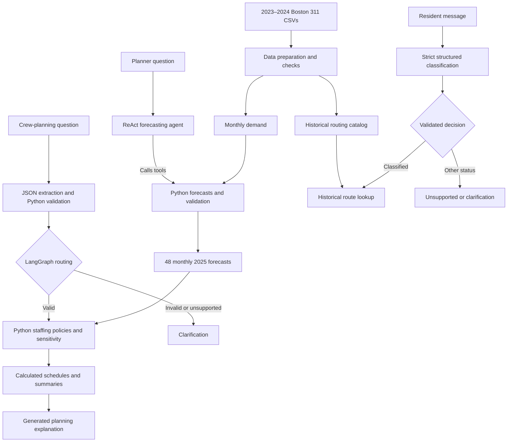

# Boston311 Crew Planner

A Python notebook project for deciding how many field crews four Boston departments need each month in 2025, using real 2023–2024 Boston 311 service requests.

The project combines transparent demand forecasts, dynamic staffing schedules, sensitivity analysis, and GenAI assistants. Language models interpret questions and explain results; Python calculates and validates numerical outputs.

## Start Here

Run [the integrated notebook](notebooks/05_integrated_notebook.ipynb) from a fresh kernel. It executes all four components in order; the individual notebooks do not need to be run first.

**Recommended plan:** hire-and-hold, selected from three heuristic policies using an explicit backlog-first decision rule. Its 48 department-month rows are saved in [crew_plan_recommended.csv](outputs/crew_plan_recommended.csv).

**Demo video:** TODO — add the three-minute video link before submission.

## Scope

| Code | Department |
|---|---|
| PWDx | Public Works |
| BTDT | Transportation |
| PARK | Parks & Recreation |
| ISD | Inspectional Services |

The preparation stage retains 558,663 requests across these departments and produces 96 historical department-month observations. The forecasting stage generates 48 estimates for January–December 2025. Intake is a separate prototype covering 16 selected request types; it does not feed new requests into the staffing simulation.

## Architecture



Intake route suggestions come from Python catalog lookup. The model does not generate department or queue names. No RAG pipeline is implemented.

## Course Techniques

| Technique | Implementation | Contribution |
|---|---|---|
| LangChain ReAct agent | `Tool`, `PromptTemplate`, `create_react_agent`, `AgentExecutor` | Selects forecasting and validation functions and explains their observations |
| Prompt engineering | Forecasting, planning extraction, planning explanation, and intake instructions | Defines supported tasks, boundaries, and interpretation rules |
| API calls and JSON extraction | Crew-planning request interpretation | Converts natural language into candidate calculation inputs |
| LangGraph | Conditional planning workflow | Routes validated requests to calculations or clarification |
| Strict structured output | Intake JSON Schema plus Python checks | Constrains statuses and request labels and checks their consistency |

Python performs the numerical work so forecasts, capacity, backlog, and costs remain reproducible and inspectable. JSON syntax and schema validation do not establish semantic correctness. Generated explanations require review against the calculated tables.

## Setup and Execution

### 1. Create the environment

```bash
git clone https://github.com/nithyaak7/boston311-crew-planner.git
cd boston311-crew-planner
conda create -n boston311 python=3.11 -y
conda activate boston311
python -m pip install langchain-classic langchain-core langchain-openai langgraph pandas matplotlib python-dotenv openai httpx ipykernel
python -m ipykernel install --user --name boston311 --display-name "Python (boston311)"
```

### 2. Provide the source data

Obtain the Boston 311 CSVs specified in the [data instructions](data/raw/README.md) and place them in `data/raw/` with these exact filenames:

- `lagan_311_open_data_2023_rvsd3.csv`
- `lagan_311_open_data_2024_rvsd3.csv`

Raw source CSVs are kept local. Preserve the original column names; the notebook selects the required fields. Root discovery searches the current folder and its parents for `data/raw/`. If necessary, set `PROJECT_ROOT_OVERRIDE` in the setup cell to the absolute repository path.

### 3. Configure API access

Create a repository-root `.env` file:

```dotenv
OPENAI_API_KEY=your_api_key
OPENAI_MODEL=gpt-4.1-mini
DEFAULT_CHAT_MODEL=gpt-4.1-mini
```

Use model IDs available to your account and compatible with the notebook's API formats. The attached reference run used `gpt-4.1-mini` for both planning and intake. `OPENAI_MODEL` configures forecasting and crew planning; intake uses `DEFAULT_CHAT_MODEL`, then `OPENAI_MODEL`, then its built-in fallback. Existing environment variables take precedence. Keep `.env` out of Git.

The integrated notebook requires credentials during setup. Its intake-only fallback prompt does not make the full notebook runnable without an API key. API calls require internet access and may incur charges. Intake alone makes 46 calls for its demonstrations and evaluations; the other assistants make additional calls.

### 4. Run the notebook

Open `notebooks/05_integrated_notebook.ipynb` in VS Code or Jupyter, select **Python (boston311)**, and choose **Restart Kernel → Run All**. Save the executed notebook after inspecting its outputs. A Jupyter frontend must be installed separately if it is not already available.

Generated CSVs overwrite files with the same names. Expected API failures in protected demonstrations print failure messages and skip their success paths. Calculation errors and failed assertions remain visible. Completing the run is not proof that every API demonstration succeeded: inspect failure messages and evaluation tables.

## Methods and Assumptions

### Data preparation

Check identifiers, duplicates, missing values, and timestamp integrity; count requests by opening month and department; and build historical type–department–queue frequencies. Missing closure and SLA target dates remain missing. Incoming demand is not completed work.

### Demand forecasting

Use a seasonal naïve baseline: each 2025 monthly estimate repeats the corresponding 2024 count. Historical validation predicts 2024 using only 2023 observations. Metrics are MAE, WAPE, and mean error, where error is predicted minus actual demand.

| Department | Historical validation WAPE |
|---|---:|
| Transportation | 7.79% |
| Inspectional Services | 12.69% |
| Parks & Recreation | 15.91% |
| Public Works | 13.76% |

These describe 2024 validation, not 2025 accuracy. Two years of history and one validation year limit the evidence. The agent does not improve the statistical forecast.

### Dynamic staffing

| Department | Starting crews | Requests per crew per working day | Annual cost per crew |
|---|---:|---:|---:|
| Public Works | 50 | 12 | $130,000 |
| Transportation | 18 | 15 | $110,000 |
| Parks & Recreation | 10 | 6 | $120,000 |
| Inspectional Services | 16 | 4 | $140,000 |

The model uses 21 working days per month, a one-month hiring/training delay, a one-month release notice, and a release fee of 25% of annual crew cost. Parks seasonal crews are available April–October at 1.3 times the permanent monthly cost, with immediate productivity and no release fee.

Team assumptions include zero starting backlog, no pre-January staffing actions, paid but unproductive training crews, paid and productive notice-period crews, release fees charged on departure, no work transfers between departments, and no terminal workforce value after December. Seasonal counts can vary monthly. Backlog carries forward; unused capacity does not.

Three policies are evaluated:

- **Fixed:** retain initial crews throughout 2025.
- **Hire-and-hold:** use one-month-ahead permanent hiring and eligible Parks seasonal crews.
- **ISD release:** modify hire-and-hold with an August notice and September departure of three ISD crews; other departments remain unchanged.

Sensitivity tests evaluate each fixed schedule at 80%, 100%, and 120% demand. They test robustness rather than recomputing staffing for each scenario. Monthly fractional demand is rounded according to the simulation, so annual totals can differ slightly from exactly multiplying the annual baseline.

## Recommendation and Results

The team recommends **hire-and-hold**. The decision rule first prefers zero baseline year-end backlog, then lower backlog under +20% demand, with annual staffing cost breaking ties.

| Policy | Annual staffing cost | Baseline year-end backlog | +20% year-end backlog |
|---|---:|---:|---:|
| Fixed | $11,920,000 | 26,845 | 81,683 |
| Hire-and-hold | $15,375,333 | 0 | 23,408 |
| ISD release | $15,340,333 | 0 | 24,416 |

Costs are rounded to the nearest dollar and exclude overdue penalties. Both adaptive policies clear baseline demand by year-end. Hire-and-hold costs $35,000 more than ISD release but leaves 1,008 fewer unfinished requests under +20% demand. It still does not absorb the full increase. This is a recommendation among three heuristic alternatives, not an optimal solution.

## Intake Evaluation and Routing

In the latest attached notebook run:

| Test set | Completed | Correct status and type |
|---|---:|---:|
| Clear synthetic baseline | 32/32 | 30/32 (93.75%) |
| Additional boundary cases | 8/8 | 8/8 (100%) |

Baseline mismatches were a damaged park bench classified as unsupported and a driveway-blocking car classified as Abandoned Vehicles instead of Parking Enforcement. All cases completed without recorded API failures. These small synthetic tests do not establish real-world accuracy, and results can vary across runs. The boundary set is exploratory, not an independent held-out benchmark. Neither set verifies department or queue correctness.

Part 1 applies the proposed 90% review threshold to unrounded fractional route shares. `routing_catalog_selected.csv` preserves fractions; the current `routing_review.csv` export stores percentages under `historical_route_share`. Part 4 does not enforce this threshold: it returns the leading historical route for classified messages. Route share is historical frequency, not model confidence. For example, the leading pothole queue represents only about 13.4% of historical pothole requests.

## Notebook and Output Guide

| Notebook | Role |
|---|---|
| `01_data_preparation.ipynb` | Historical data preparation and routing catalogs |
| `02_demand_forecasting_agent.ipynb` | Forecast calculations, historical validation, and ReAct agent |
| `03_crew_planning.ipynb` | Staffing calculations and planning graph |
| `05_integrated_notebook.ipynb` | End-to-end submission notebook, including Part 4: GenAI intake |

See [the notebook guide](notebooks/README.md) for component details.

| Location | Generated files |
|---|---|
| `data/processed/` | `monthly_demand.csv`, `routing_catalog_selected.csv`, `routing_review.csv`, `forecast_2025.csv`, `genai_intake_evaluation.csv`, `genai_intake_boundary_evaluation.csv` |
| `outputs/` | `forecast_validation_metrics.csv`, `forecast_validation_2024.csv`, `forecast_react_evaluation.csv` when extra checks run |
| `outputs/` | `crew_plan_fixed.csv`, `crew_plan_hire_and_hold.csv`, `crew_plan_isd_release.csv`, `crew_policy_summary.csv` |
| `outputs/` | `crew_sensitivity_monthly.csv`, `crew_sensitivity_summary.csv`, `crew_plan_recommended.csv` |

## Validation and Limitations

The attached run records 70 code-cell execution counts in order with no saved error outputs. It includes checks for historical and forecast row counts, unique department-month records, crew lifecycle constraints, workload accounting, clarification branches, and Parks seasonal eligibility. This describes saved execution evidence; results should be checked again in the reviewer's environment.

- SLA on-time performance and overdue costs are **not modeled**. The $20 overdue and additional $100 after 30 days constants are defined but not applied. This remains a gap relative to deadline-based service-cost analysis.
- Backlog means unfinished workload, not an overdue count. Zero year-end backlog does not establish on-time completion.
- Crews have uniform productivity within departments; weather, geography, request complexity, and individual deadlines are not modeled.
- Intake is limited to 16 types and one-turn clarification. There is no production dispatch, manual-review queue, or automatic staffing feedback from intake.
- Generated explanations can contain semantic errors despite valid JSON and correct calculation tables.

## Team Contributions

TODO — replace these placeholders with all four members' names and their actual contributions before submission. Record shared review and integration work as well as component ownership.

| Member | Implemented work | Review and integration |
|---|---|---|
| Nithyaa Kesavamurthy | Data prep, Demand Forecasting and Staff Planning | Integrated the data preparation with the demand forecasting and Crew plannning |
| Tatsuya Hommaru | GenAI intake | Integrated the intake section into the final notebook |
| DiVeighna Tulloch | Demo Video and Presentation Script | [Actual contribution] |
| Sanjit Lanka | Integrated Notebook Review  | Validated end to end execution |

## AI-use Disclosure

AI assisted with code development for handling API calls failures, debugging, and Read Me documentation . The team is responsible for reviewing the implementation, verifying numerical outputs and generated explanations, and ensuring the final submission accurately represents the work performed.
